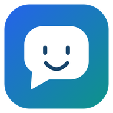
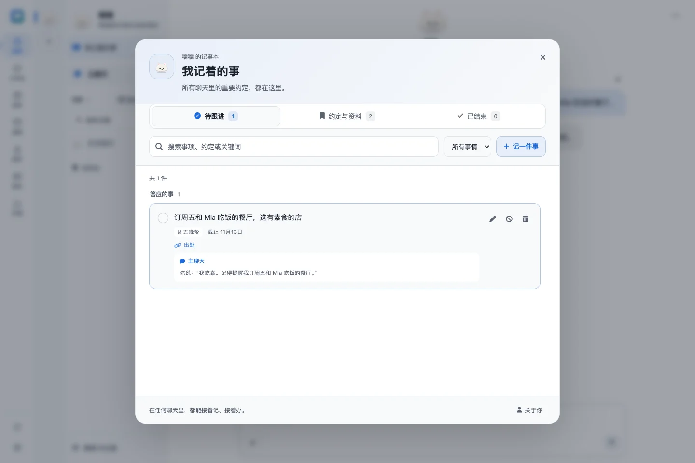
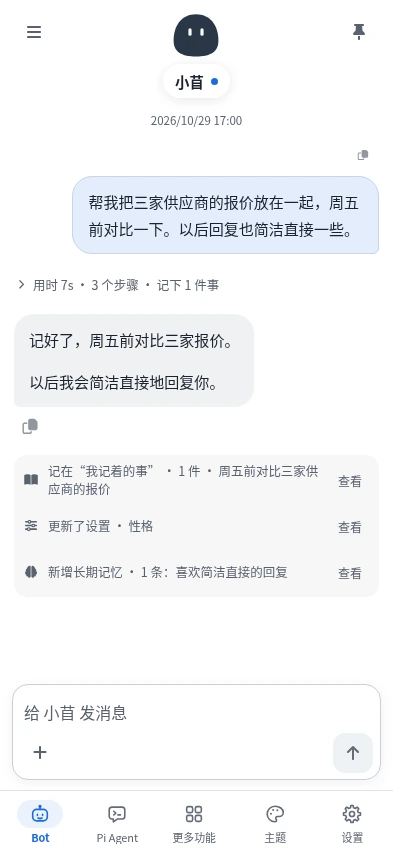
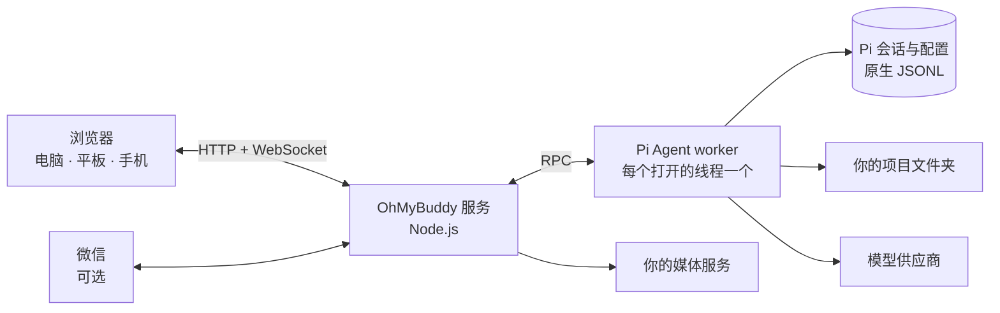

<div align="center">



# OhMyBuddy

**装在自己电脑上的 AI 伙伴：记得你，能办事，浏览器、手机和微信都能找到它。**

开源的私人 AI 助理，自带完整的编程 Agent 工作台，基于 [Pi Coding Agent](https://pi.dev)。<br>
用你自己的模型：Claude、GPT、Gemini、DeepSeek、通义千问、Kimi 等都可以。聊天、记忆和 Key 都留在你的机器上。

[](https://github.com/YogurtJ/OhMyBuddy/releases/latest)
[](LICENSE)
[](docs/INSTALL_RECOVERY.md)
[](#支持平台)
[](https://pi.dev)

[English](README.md) · **简体中文**

[下载](https://github.com/YogurtJ/OhMyBuddy/releases/latest) · [安装](docs/INSTALL_RECOVERY.md) · [用户指南](docs/USER_GUIDE.md) · [变更记录](CHANGELOG.md) · [反馈问题](https://github.com/YogurtJ/OhMyBuddy/issues/new/choose) · [讨论区](https://github.com/YogurtJ/OhMyBuddy/discussions)



</div>

> 原名 **Pivane**。旧安装的数据与设置继续兼容，详见[改名与升级说明](docs/development/NAMING.md)。

## OhMyBuddy 是什么？

OhMyBuddy 是一个自托管的网页应用，把 Pi Coding Agent 变成随时能找到的私人 AI 助理。把它装在自己的电脑上（Linux、macOS、Windows，树莓派也行），然后在电脑、平板或手机的浏览器里使用，也可以直接在微信里给它发消息。

它有两面，共用同一套运行时、模型和工具：

- **伙伴：懂你的私人助理。** 伙伴有名字、形象和性格，和你一直在同一个对话里聊；它记得跨聊天的重要信息，帮你处理日常提问、计划、笔记、资料整理、提醒和电脑上的小活。
- **工作台：完整的 Agent 工作台。** 面向真实文件夹里的项目工作：线程、流式工具调用、文件差异、子 Agent、侧聊和会话树一应俱全，会话与 Pi CLI 兼容。

## 为什么选择 OhMyBuddy

- **记得你，而且记了什么你都看得见。** 每个伙伴都有“关于你”、长期记忆、学到的技能，每个聊天还有自己的记事本。回复里保存了什么，下方就出现一条回执；每条记忆和技能都可以查看、修改或撤销。
- **在微信里派活。** 装上可选的微信连接组件并扫码后，在微信里发一句话或一张图片，家里电脑上的伙伴或 Agent 就会读文件、跑工具，做完把文件发回微信。
- **一个伙伴，所有屏幕。** 会话保存在你的服务器上，电脑、手机和微信接着同一段对话。可以添加到手机主屏幕，回复完成时收到通知。
- **真能干活。** 伙伴和 Agent 可以读写文件、执行命令、上网、使用 MCP 工具、启动子 Agent、运行定时任务。伙伴提供“放手”“稳妥”“每次都问”三种做事方式。
- **模型、Key 和机器都由你掌控。** Pi 支持的供应商都可以使用，包括 Anthropic、OpenAI、Google Gemini、GitHub Copilot、OpenRouter、DeepSeek、通义千问、Kimi、MiniMax、xAI 和 Mistral；可以用 API Key 或 OAuth 登录，也可以接入自己的 OpenAI 兼容服务。凭据和历史都保存在你自己的机器上。
- **跟着 Pi 生态一起长。** Pi 的 Packages、Skills、提示词模板和 MCP 服务器都可以在浏览器里安装，也可以让内置的扩展助手帮你查找和配置。
- **内置图像、视频和语音。** 接入自己的图像、视频和语音服务，说出想法就能得到可编辑的生成参数；也可以语音输入消息，或让回复朗读出来。

### 适合谁

- 想要一个像 ChatGPT 那样的助理，但跑在自己电脑上、用自己的 Key，并且跨对话记得你。
- 在用 Pi 或其他编程 Agent，希望在电脑前开个长任务，出门后用手机看进度。
- 生活和工作都在微信里，想把活儿交给家里的 Agent，做完直接在微信里收文件。
- 想把聊天、Agent、定时任务和媒体生成放在一个地方，而不是装好几个工具。

## 功能

### 伙伴：记得你的私人助理

- 给伙伴起名字、选头像、定性格和工作目录。可选的两三分钟“互相认识”会问清怎么称呼你、主要帮你做什么、该怎么做事，也可以跳过。
- 每个伙伴有一个一直聊下去的主聊天和最多 100 个话题。每个聊天都有自己的“我记着的事”，记下定好的事、答应的事、截止时间和待回答的问题；话题共用这个伙伴的记忆与技能。
- 长聊天一直好用：旧工具输出会被省略，空闲时在后台整理摘要；更早的聊天可以只读回看，伙伴也能按原话翻找。
- 每轮只显示一个回复和一行可展开的过程摘要；记忆、记事本、技能、设置和定时任务的变化都以回执呈现，点开即可查看。
- 可以同时有多个伙伴，记忆互不共享；新伙伴可以从其他伙伴勾选复制“关于你”。
- 主动联系和后台学习在伙伴设置里各有开关和额度。详见 [伙伴模式](docs/BOT_MODE.md)。

### 工作台：项目、线程与工具

- 线程按项目组织，直接在服务器上的文件夹里工作。
- 回复会流式显示思考过程、工具调用和本轮修改的文件。默认的简洁视图会把每个已完成的轮次收成一行“用时 · 工具调用”摘要。
- 可以粘贴或拖放图片和文件作为附件，用 `@` 引用项目文件，也可以把选中的文字引用到下一条消息里。上传 DOCX、XLSX、PPTX 和 PDF 会保留原件，Agent 按需读取选定范围。
- 任务运行时，可以发送引导或排队一条后续消息，也可以停止、重试或压缩上下文。
- `!命令` 在服务器上执行 Shell 命令；`!!命令` 的输出不会进入模型上下文。
- 模型选择器支持搜索、跨设备同步的常用模型、按模型调整的思考等级，并显示上下文用量；进度卡会显示 Agent 正在执行的计划。
- 在任意项目里可以“以身份新建…”线程，选一个伙伴，把它的性格、记忆和技能带进项目工作。

### 会话与历史

- 会话使用 Pi 原生的 JSONL 文件，因此与 Pi CLI 保持兼容，不会另外复制到单独的聊天数据库。
- 可以全文搜索所有线程、给消息加书签、查看会话树、分叉对话，或编辑消息后重试。
- 可以导入 Pi 会话，也可以导出为 HTML 或 JSONL。
- 项目和线程可以归档，线程可以移动到其他项目。新线程会自动生成标题。

### 多 Agent 与自动化

- 内置 [pi-subagents](https://pi.dev/packages/pi-subagents) 子 Agent。实时面板显示每次运行的状态和所用模型，可以引导、停止或继续运行，并统计 token 用量和费用。
- Agent 可以新开任务线程，也可以给同一项目里的其他线程发消息。
- 侧聊可以让你临时问个问题，不打断主任务。它可以读取文件；在你为当次回复授权后，也可以做小范围修改。
- 定时任务支持 cron 和单次执行，可以设置时区，预览接下来的运行时间，设置预算并查看运行记录。

### 记忆与学习

- 伙伴和助手身份都有自己的人设、关于你的偏好记录和长期记忆，由 [pi-hermes-memory](https://pi.dev/packages/pi-hermes-memory?name=memory) 提供支持。概览、设定、记忆、技能、学习分别展示待处理变化、内容和预算。
- 可以开启后台学习，在每日预算内从你的纠正和偏好中学习。
- 多个逻辑项目可以指向同一个目录，并各自带有项目指令。

### 微信

- 按需安装可选的微信连接组件，扫码登录，只允许指定用户。连接的是微信 ClawBot（iLink）机器人身份，不会接管你个人微信号的聊天。
- 可以在微信里和伙伴聊天，也可以把私聊绑定到工作台线程。支持发送文字和图片，最终回复、交付文件和定时通知都会发回微信。
- 斜杠指令可以切换伙伴（`/bot`、`/伙伴` 或 `/切换`）和话题（`/topic`）、修改模型与思考等级、查看状态、停止或确认任务；浏览器中可以查看连接状态与投递回执。详见[消息渠道](docs/MESSAGE_CHANNELS.md)。

### 文件与渲染

- 可以浏览和搜索项目文件，查看每轮的修改差异，并与当前文件对照。
- 支持预览 Markdown、代码、图片、PDF、CSV/TSV、SVG、音频，以及在隔离环境中显示的 HTML。全屏阅读保留位置，图片支持拖动和缩放，PDF 保留页码与缩放。
- Agent 可以把完成的文件发布为不可更改的快照，你可以在聊天里直接打开和下载。
- Markdown 支持代码高亮、LaTeX 公式（KaTeX）和 Mermaid 图表。

### 扩展与 MCP

- 可以在全局或单个项目范围内管理 Pi 的 Packages、Skills、扩展、提示词模板和主题。
- MCP 使用 Pi 的原生支持，包括 Codemode 和工具搜索。MCP 服务器和 OAuth 登录都在浏览器里管理。
- 发现页可按类型和安装状态筛选，卡片内展开前提与示例。扩展助手先核对来源，你要求后才会安装；已安装的扩展包和技能显示版本，并可手动检查更新。
- 可以编辑系统提示词，并查看任一线程实际收到的完整提示词。

### 多媒体实验室与语音

- 可以接入图像、视频、语音合成和语音转写服务。预设包括 OpenAI、Google Gemini、火山方舟（Seedream 和 Seedance）和阿里云百炼，其他兼容的 HTTP API 可以手动添加。
- Agent 会在聊天或实验室里根据自然语言描述起草可编辑的参数。对话按媒体类型设置自动执行或等待确认；视频默认需要确认。模型支持时，还可以附上参考图片或视频。
- 生成历史可以预览、复用和下载以前的结果。
- 可以用语音在输入框里输入消息，也可以让回复或选中的文字朗读出来。

### 日常使用

<p align="center"></p>

- 布局会适应电脑、平板和手机屏幕，OhMyBuddy 也可以添加到手机主屏幕。
- 提供页面通知和提示音，并可选开启 Web Push 后台提醒。
- 用量统计按日期、供应商、模型、项目和会话汇总 token 和估算费用。
- 提供浅色和深色主题，可以调整字号，界面可选英文或简体中文。
- 用访问 Token 保护你的实例。OhMyBuddy 作为后台服务运行，并提供桌面入口。它会检查新版本，并生成升级提示词，你可以交给部署机器上的 Agent 执行。

## 快速开始

当前锁定依赖要求使用 **Node.js 22.x（22.19.0 或更新的 22.x，含 npm）**、`bash` 和 [ripgrep](https://github.com/BurntSushi/ripgrep)（Windows 上可以通过 Git for Windows 获得 Bash），以及一个模型供应商的账户。不需要全局安装 Pi，不需要构建前端，也不需要 GPU。

```bash
# 1. 从 Releases 下载 ohmybuddy-<version>.tar.gz 及其 .sha256 文件，然后校验压缩包
sha256sum -c ohmybuddy-<version>.tar.gz.sha256    # macOS：shasum -a 256 -c …
tar -xzf ohmybuddy-<version>.tar.gz && cd ohmybuddy-<version>

# 2. 安装锁定版本的依赖，其中包括固定版本的 Pi 运行时
node scripts/install.cjs

# 3. 先在前台运行试用
npm start
```

打开 <http://127.0.0.1:11408>，检查 **设置 → 供应商与模型**，然后打开 **伙伴** 认识你的第一个伙伴，或在 **工作台** 里选一个项目文件夹。

日常使用时，请按[安装指南](docs/INSTALL_RECOVERY.md)（另有 [macOS](docs/MACOS.md) 和 [Windows](docs/WINDOWS.md) 版本）把数据放在应用目录之外，然后运行 `node scripts/install-service.cjs`。这样 OhMyBuddy 会在后台运行，并在你登录时自动启动；在 macOS 和 Windows 上还会添加桌面入口。

**让编程 Agent 帮你装。** 在目标电脑上把下面这段话发给 Claude Code、Codex、Pi 或其他 Agent：

```text
请在这台电脑上安装 OhMyBuddy：https://github.com/YogurtJ/OhMyBuddy
按仓库里的 docs/AGENT_GUIDE.md 和本平台的安装指南操作：使用最新 Release，
校验压缩包哈希，安装为后台服务，最后告诉我访问地址、版本和数据路径。
不要打印或复制我的任何 API Key。
```

> **已经在用 Pi CLI？** OhMyBuddy 默认使用同一个 Pi 身份，你的模型、登录、设置和会话都能直接使用。请不要同时从 CLI 和网页写入同一个会话。详见[已有 Pi 接入](docs/PI_CLI.md)。

## 支持平台

OhMyBuddy 可以**直接在 Linux、macOS 和 Windows 上运行**，不需要 WSL 或 Docker。它足够轻量，可以部署在树莓派上，并且可以用任何现代浏览器访问。

OhMyBuddy 默认只监听本机。如果要从手机或其他电脑访问，请先开启访问 Token，然后通过局域网、Tailscale 等 VPN，或 HTTPS 反向代理连接。详见[网络与访问](docs/ACCESS_CONTROL.md)。

## 工作原理



- Node.js 服务（Express 和 WebSocket）提供纯 JavaScript 前端，不需要构建步骤。
- 每个持久线程（包括伙伴的每个聊天和话题）只由一个 Pi worker 进程提供服务，打开它的所有浏览器都连接到同一个 worker。
- Pi 的 SessionManager 和 JSONL 文件是每段对话唯一的记录。用量统计保存在单独的账本里，不保存消息内容。
- 每个 OhMyBuddy 版本都内置一个经过测试的 Pi 版本，Pi 随 OhMyBuddy 一起升级。

## 安全模型

- OhMyBuddy 面向**个人、单用户**的实例。拿到访问 Token 的人共用同一个实例，没有单独的用户账户。
- 项目根目录限制了可以浏览的文件夹，但它**不是沙箱**。伙伴、Agent、Shell、Packages 和扩展都以服务器用户的权限运行；伙伴的做事方式只决定什么时候先问你，也不是操作系统沙箱。请只安装你信任的扩展。
- 只有允许列表里的微信用户能进入绑定的聊天，他们可以使用该聊天已有的工具，请只添加你信任的人。
- 媒体按你设置的各类型对话自动执行偏好和确认策略运行。失败或结果不确定的提交不会自动重放。

## 常见问题

**伙伴和工作台有什么区别？** 伙伴是一段持续的私人对话，隐藏项目、模型和上下文这些控制；工作台是面向项目文件夹的完整 Agent 工作台。两者用同一个 Pi 运行时，也可以“以身份新建”一个工作台线程，把伙伴的记忆带进去。

**它只是 Pi 的网页界面吗？** 最早是，那时叫 Pivane。现在它仍然直接使用 Pi 的运行时和会话文件，但伙伴、看得见的记忆、微信、定时任务和媒体实验室，让它成了日常不用打开终端也能用的私人 Agent。

**和 OpenClaw、Hermes Agent 有什么不同？** 它们都在你自己的机器上用你自己的模型运行 Agent。OhMyBuddy 以浏览器为中心：记忆变化以回执呈现、可以核对，自带 Pi 编程工作台，微信通过 ClawBot 接入。如果你主要想把一个助理接进很多聊天软件，OpenClaw 支持的渠道更多。

**它能替代 Pi CLI 吗？** 不能，它是 Pi CLI 的搭档。两者共用同一个 Pi 身份，你可以根据场景选择使用哪一个。

**需要 GPU 吗？** 不需要。模型运行在你的供应商那里，或运行在你自己配置的服务上。

**怎么升级？** **设置 → 版本与更新**会提示新版本；配置了签名分发源的完整平台包可在这里确认更新，由独立启动器备份并切换。源码和旧安装继续提供独立 Agent 提示词。安装方式与备份边界见[版本与更新](docs/UPDATES.md)和[安装与恢复](docs/INSTALL_RECOVERY.md)。

**支持哪些语言？** 界面支持英文和简体中文。对话可以使用你的模型支持的任何语言。

## 给 AI Agent

如果你是帮用户安装、配置、升级或排查 OhMyBuddy 的 AI Agent，请从[用户 Agent 操作指南](docs/AGENT_GUIDE.md)开始；只有被要求修改源码时才阅读 [AGENTS.md](AGENTS.md)。

- **是什么**：自托管的私人 AI Agent（带记忆的“伙伴”），加上编程 Agent 工作台（“工作台”），原名 Pivane，ISC 许可证。
- **代码中的名称**：接口、数据目录和微信指令把伙伴称为 `bot`（`/api/pi/bots`、`/bot`）；工作台标签是 `chat`。
- **运行环境**：Node.js 22.x（22.19.0 或更新）、npm、`bash` 和 ripgrep；不需要构建、GPU、Docker 或全局安装 Pi。
- **默认地址**：`http://127.0.0.1:11408`。默认只监听本机；允许其他设备访问前先开启访问 Token。
- **引擎**：固定版本的 [Pi Coding Agent](https://pi.dev) 运行时；对话是 Pi 原生 JSONL 会话，与 Pi CLI 兼容。
- **接口**：[REST 与 WebSocket API](docs/API.md)、[后台服务](docs/BACKGROUND_SERVICE.md)、[与 Pi CLI 共存](docs/PI_CLI.md)。

## 文档

| 主题 | 入口 |
|---|---|
| 安装、升级与恢复 | [安装与恢复](docs/INSTALL_RECOVERY.md) · [macOS](docs/MACOS.md) · [Windows](docs/WINDOWS.md) · [后台服务](docs/BACKGROUND_SERVICE.md) |
| 日常使用 | [用户指南](docs/USER_GUIDE.md) |
| 伙伴 | [伙伴模式](docs/BOT_MODE.md) · [微信与消息渠道](docs/MESSAGE_CHANNELS.md) |
| 全部功能详解 | [文档目录](docs/README.md) |
| REST 和 WebSocket API | [API 参考](docs/API.md) |
| 让自己的 Agent 帮忙 | [用户 Agent 操作指南](docs/AGENT_GUIDE.md) |
| 版本变化与后续计划 | [变更记录](CHANGELOG.md) · [Releases](https://github.com/YogurtJ/OhMyBuddy/releases) · [路线图](docs/ROADMAP.md) |

## 参与贡献

欢迎各种反馈，可以先看看[欢迎帖](https://github.com/YogurtJ/OhMyBuddy/discussions/4)。

- **Bug 和功能建议**：[新建 issue](https://github.com/YogurtJ/OhMyBuddy/issues/new/choose)。报告 Bug 时请写明 OhMyBuddy 版本和最短的复现步骤。
- **使用问题、交流和分享**：到 [Discussions](https://github.com/YogurtJ/OhMyBuddy/discussions) 发帖，或直接在欢迎帖下留言。不确定发哪里也没关系，随便发，我都会看到。
- **PR**：非常欢迎，可以从带 [`good first issue`](https://github.com/YogurtJ/OhMyBuddy/labels/good%20first%20issue) 标签的任务开始。

日志和截图请先去除凭据和私人内容。

先阅读[贡献指南](CONTRIBUTING.md)和[开发文档](docs/development/README.md)，再运行 `node scripts/install.cjs` 搭建开发环境。按[验证矩阵](docs/development/WORKFLOW.md#验证矩阵)选择覆盖本次改动的定向测试与检查；纯文档改动只核对事实并运行 `npm run check:docs`。编程 Agent 还应阅读 [AGENTS.md](AGENTS.md)。

如果 OhMyBuddy 对你有用，点个 Star 能帮更多人找到它。

## 许可证

OhMyBuddy 使用 [ISC 许可证](LICENSE)。Pi、Font Awesome、KaTeX、Mermaid 等内置组件保留各自的许可证，详见[第三方声明](THIRD_PARTY_NOTICES.md)。
